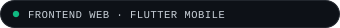
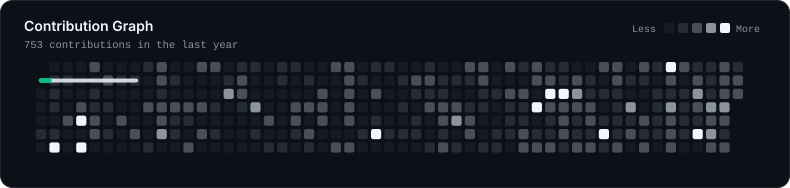

<!-- 1. HERO SECTION (BINARY PORTRAIT ON LEFT, PERSONAL BRAND BESIDE IT) -->

<picture>
  <source media="(prefers-color-scheme: light)" srcset="./assets/status-light.svg" />
  
</picture>

# Tharindu Nimesh

**Interfaces engineered for clarity, speed, and feel.**

Frontend Web & Flutter Mobile App Developer crafting modern digital experiences with **React**, **Next.js**, and **Flutter**—obsessed with UI/UX precision, clean architecture, and fluid performance.

 

 

<!-- 2. SHORT INTRODUCTION -->
<code>01</code> &nbsp;·&nbsp; <strong>INTRODUCTION</strong>

Great software is felt in the details—the responsiveness of a layout, the restraint of a micro-interaction, and the clarity of the architecture underneath. I build modern web applications and cross-platform mobile experiences where design craft and frontend engineering work as one.

 

<!-- 3. MINIMAL SINGLE-LINE TECH STACK SHOWCASE (ICONS ONLY) -->
<code>02</code> &nbsp;·&nbsp; <strong>TECH STACK</strong>

  <picture>
    <source media="(prefers-color-scheme: light)" srcset="./assets/tech-dock-light.svg" />
    
  </picture>

 

<!-- 4. CURRENT FOCUS SECTION -->
<code>03</code> &nbsp;·&nbsp; <strong>CURRENT FOCUS</strong>

  <picture>
    <source media="(prefers-color-scheme: light)" srcset="./assets/focus-light.svg" />
    
  </picture>

 

<!-- 5. GITHUB STATS SECTION -->
<code>04</code> &nbsp;·&nbsp; <strong>GITHUB STATS</strong>

  <picture>
    <source media="(prefers-color-scheme: light)" srcset="./assets/analytics/stats-light.svg" />
    
  </picture>
  <picture>
    <source media="(prefers-color-scheme: light)" srcset="./assets/analytics/streak-light.svg" />
    
  </picture>

 

<!-- 6. CONTRIBUTION GRAPH -->
<code>05</code> &nbsp;·&nbsp; <strong>CONTRIBUTION GRAPH</strong>

  <picture>
    <source media="(prefers-color-scheme: light)" srcset="./assets/analytics/snake-light.svg" />
    
  </picture>

 

<!-- 7. CONNECT SECTION (MINIMAL MODERN ICON LINKS ONLY) -->
<code>06</code> &nbsp;·&nbsp; <strong>CONNECT</strong>

  <a href="https://tharinduxn.dev" title="Portfolio — tharinduxn.dev">
    <picture>
      <source media="(prefers-color-scheme: light)" srcset="./assets/icons/portfolio-light.svg" />
      
    </picture>
  </a>
  &nbsp;&nbsp;
  <a href="https://www.linkedin.com/in/tharinduxn/" title="LinkedIn — in/tharinduxn">
    <picture>
      <source media="(prefers-color-scheme: light)" srcset="./assets/icons/linkedin-light.svg" />
      
    </picture>
  </a>
  &nbsp;&nbsp;
  <a href="https://github.com/tharinduxn" title="GitHub — @tharinduxn">
    <picture>
      <source media="(prefers-color-scheme: light)" srcset="./assets/icons/github-light.svg" />
      
    </picture>
  </a>
  &nbsp;&nbsp;
  <a href="mailto:tharinduxn@gmail.com" title="Email — tharinduxn@gmail.com">
    <picture>
      <source media="(prefers-color-scheme: light)" srcset="./assets/icons/email-light.svg" />
      
    </picture>
  </a>

