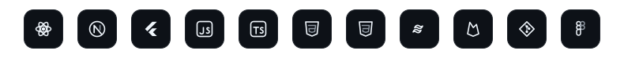
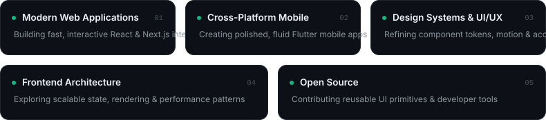
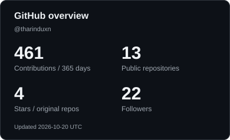
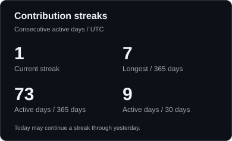
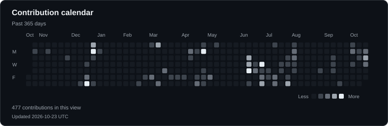

<h1>
  Tharindu Nimesh
  &nbsp;&nbsp;&nbsp;
  
  &nbsp;
  <a href="https://www.linkedin.com/in/tharinduxn/" title="LinkedIn: in/tharinduxn">
    <picture>
      <source media="(prefers-color-scheme: light)" srcset="./assets/icons/linkedin-light.svg" />
      
    </picture>
  </a>
  &nbsp;
  <a href="https://github.com/tharinduxn" title="GitHub: @tharinduxn">
    <picture>
      <source media="(prefers-color-scheme: light)" srcset="./assets/icons/github-light.svg" />
      
    </picture>
  </a>
  &nbsp;
  <a href="mailto:tharinduxn@gmail.com" title="Email: tharinduxn@gmail.com">
    <picture>
      <source media="(prefers-color-scheme: light)" srcset="./assets/icons/email-light.svg" />
      
    </picture>
  </a>
</h1>

<strong>Interfaces engineered for clarity, speed, and feel.</strong>

Frontend web and Flutter mobile developer. Great software is felt in the details: the responsiveness of a layout, the restraint of a micro-interaction, and the clarity of the architecture underneath. I build modern web applications and cross-platform mobile experiences where design craft and frontend engineering work as one.

## Tech stack

  <picture>
    <source media="(prefers-color-scheme: light)" srcset="./assets/tech-dock-light.svg" />
    
  </picture>

## Current focus

  <picture>
    <source media="(prefers-color-scheme: light)" srcset="./assets/focus-light.svg" />
    
  </picture>

<!--
## Selected work

Add 2 to 4 of your best projects here. A plain list ages better than a widget:

- **[Project name](https://github.com/tharinduxn/repo)**: one line on what it does and the stack behind it.
- **[Project name](https://github.com/tharinduxn/repo)**: one line on what it does and the stack behind it.
-->

## GitHub stats

  <picture>
    <source media="(prefers-color-scheme: light)" srcset="./assets/analytics/stats-light.svg" />
    
  </picture>
  <picture>
    <source media="(prefers-color-scheme: light)" srcset="./assets/analytics/streak-light.svg" />
    
  </picture>

## Contribution calendar

  <picture>
    <source media="(prefers-color-scheme: light)" srcset="./assets/analytics/calendar-light.svg" />
    
  </picture>

